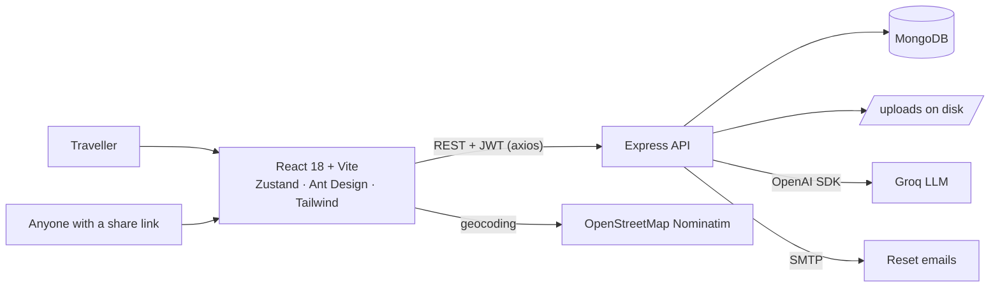
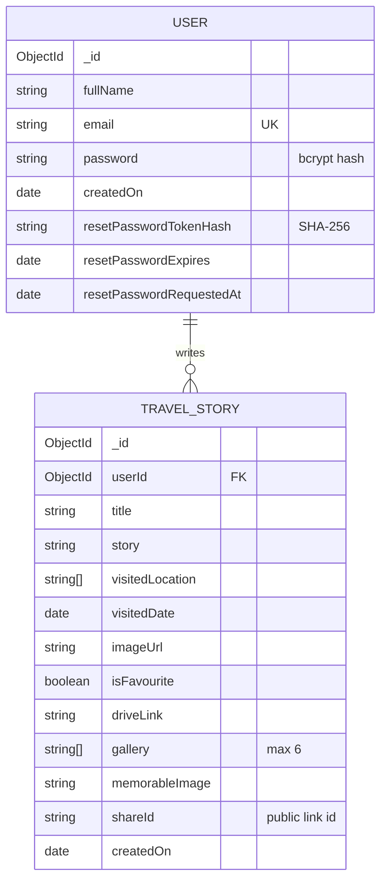

# Travel Story


A full-stack **MERN travel journal**. Write about the places you've been, attach a cover photo and locations, and every story turns into a **flip-through story book** with a photo gallery, a "most memorable" photo, a map of the places you visited, and a **PDF download**. Share a story with a public read-only link, and let AI suggest where to go next or polish your writing.

---

## Contents

- [Features](#features)
- [User stories](#user-stories)
- [Architecture](#architecture)
- [Tech stack](#tech-stack)
- [Data model](#data-model)
- [API reference](#api-reference)
- [The story book](#the-story-book)
- [AI features](#ai-features)
- [Security](#security)
- [Getting started](#getting-started)
- [Project structure](#project-structure)
- [Roadmap](#roadmap)

---

## Features

- **Accounts**: sign up and log in with JWT. Passwords are hashed with bcrypt. Update your profile, change your password, or reset a forgotten one by email.
- **Travel stories**: create, edit and delete stories with a title, text, cover image, visited places, visit date and an optional Google Drive photo link.
- **Story book**: every story opens as an interactive book with an index, "at a glance", story pages, most memorable photo, a gallery of up to 6 photos, a map, places visited, and links.
- **PDF export**: download the whole book as a PDF.
- **Map**: places are geocoded with OpenStreetMap (Nominatim) and shown on a Leaflet map.
- **Search and filter**: multi-keyword search across title, text and places (quoted phrases supported), plus a date-range filter.
- **Favourites**: pin your best trips to the top.
- **Public sharing**: create or revoke a read-only link for any story.
- **AI**: destination ideas based on your past trips, and one-click story polishing (Groq).
- **Animated 3D background and book showcase**, built with three.js.

> **Note:** forgot-password and PDF export are on the `feature/forgot-password-and-pdf` branch and arrive on `main` when it's merged.

---

## User stories

### Epic 1: Account

| ID | Story | Acceptance criteria |
|----|-------|---------------------|
| TS-01 | As a traveller, I want to **create an account** so that my journal is private. | Full name, email and password are required. Email is unique and lower-cased. The password is bcrypt-hashed. I'm logged in afterwards. |
| TS-02 | As a traveller, I want to **log in** and stay logged in. | Valid credentials return a JWT that lasts 72 hours. The app sends it on every request. |
| TS-03 | As a traveller, I want to **reset a forgotten password** by email. | The response is the same whether or not the email exists. The link expires in 30 minutes and works once. Requests are limited to one per minute. Only a SHA-256 hash of the token is stored. |
| TS-04 | As a traveller, I want to **update my name and change my password**. | I must enter my current password to change it. The new password needs at least 6 characters. Password and reset hashes are never returned by the API. |

### Epic 2: Writing stories

| ID | Story | Acceptance criteria |
|----|-------|---------------------|
| TS-05 | As a traveller, I want to **write a story** about a trip. | Title, text, at least one place, visit date and cover image are required. A Drive link is optional and must be http(s). |
| TS-06 | As a traveller, I want to **upload a cover photo**. | Images only, up to 5 MB, saved on the server under a generated file name. |
| TS-07 | As a traveller, I want to **edit or delete** a story. | Only my own stories. Deleting a story also deletes its cover, gallery and memorable photo files. |
| TS-08 | As a traveller, I want to **mark favourites** so that my best trips stay on top. | Favourites sort first in every list, search and filter. |

### Epic 3: Reliving trips

| ID | Story | Acceptance criteria |
|----|-------|---------------------|
| TS-09 | As a traveller, I want to **read a story as a book**. | Pages: index, at a glance, the story split across pages, most memorable photo, gallery, map, places, links. I can jump from the index to a page. |
| TS-10 | As a traveller, I want to **fill a photo gallery** and pick a **most memorable photo**. | Up to 6 frames. Only images uploaded through the app are accepted. Replaced photos are deleted from disk. |
| TS-11 | As a traveller, I want to **see my trip on a map**. | Places are geocoded (cached in the browser, at most one request per second to respect Nominatim's policy) and pinned on the map. |
| TS-12 | As a traveller, I want to **download my story as a PDF**. | The book is rendered and saved as a PDF from the browser. |
| TS-13 | As a traveller, I want to **search** my stories. | Every keyword must appear in the title, text or a place. `"Namche Bazaar"` in quotes matches as a phrase. Search is case-insensitive and keywords are matched literally (regex-escaped). |
| TS-14 | As a traveller, I want to **filter by date range**. | Only stories visited between the chosen dates are shown. |

### Epic 4: Sharing and AI

| ID | Story | Acceptance criteria |
|----|-------|---------------------|
| TS-15 | As a traveller, I want to **share a story with a link** so that friends can read it without an account. | A random 24-character share ID is created (or reused). `/shared/:shareId` is public and read-only, and hides the owner's ID. |
| TS-16 | As a traveller, I want to **stop sharing** a story. | Revoking clears the share ID, and the old link stops working. |
| TS-17 | As a traveller, I want **ideas for my next trip** based on where I've been. | The AI suggests 4 places I haven't visited, each with country, reason and best time to go. It needs at least one story. |
| TS-18 | As a writer, I want to **polish my story** without losing my voice. | The AI improves grammar and flow, keeps my facts, first person and roughly the same length, and returns only the text. |
| TS-19 | As the owner of the app, I want it to **keep working when AI isn't configured**. | AI routes return `503` with a clear message. Everything else still works. |

---

## Architecture



---

## Tech stack

| Layer | Technologies |
|-------|--------------|
| Frontend | React 18, Vite 6, React Router 7, Zustand, Ant Design 6, Tailwind CSS 3, Axios, Leaflet / react-leaflet, three.js, motion, jsPDF + html2canvas, dayjs, react-toastify |
| Backend | Node.js, Express 4, Mongoose 8, JSON Web Tokens, bcrypt, Multer, Nodemailer |
| AI | Groq through the `openai` SDK (OpenAI-compatible), default model `llama-3.3-70b-versatile` |
| Database | MongoDB |

---

## Data model



---

## API reference

Base URL: `http://localhost:8001`. 🔒 means the route needs `Authorization: Bearer <token>`.

### Auth and user

| Method | Path | Description |
|--------|------|-------------|
| POST | `/create-account` | `{fullName, email, password}` → `{user, accessToken}` |
| POST | `/login` | `{email, password}` → `{user, accessToken}` |
| POST | `/forgot-password` | `{email}`. Always returns the same message. |
| POST | `/reset-password` | `{token, password}` |
| GET | `/get-user` 🔒 | Current user (no password or reset fields) |
| PUT | `/update-profile` 🔒 | `{fullName}` |
| PUT | `/change-password` 🔒 | `{currentPassword, newPassword}` (min 6 characters) |

### Stories

| Method | Path | Description |
|--------|------|-------------|
| POST | `/add-travel-story` 🔒 | Create a story |
| GET | `/get-all-stories` 🔒 | My stories, favourites first |
| PUT | `/edit-story/:id` 🔒 | Update a story |
| DELETE | `/delete-story/:id` 🔒 | Delete a story and its image files |
| PUT | `/update-is-favourite/:id` 🔒 | `{isFavourite}` |
| PUT | `/stories/:id/photos` 🔒 | `{gallery?, memorableImage?}` |
| GET | `/search?query=` 🔒 | Multi-keyword search |
| GET | `/travel-stories/filter?startDate=&endDate=` 🔒 | Date range (epoch ms) |
| POST | `/stories/:id/share` 🔒 | Create or reuse a public link |
| DELETE | `/stories/:id/share` 🔒 | Revoke the public link |
| GET | `/shared/:shareId` | Public read-only story |

### Uploads, AI and health

| Method | Path | Description |
|--------|------|-------------|
| POST | `/image-upload` 🔒 | multipart field `image` (image/*, ≤ 5 MB) → `{imageUrl}` |
| DELETE | `/delete-image?imageUrl=` 🔒 | Remove an uploaded file |
| GET | `/ai/travel-suggestions` 🔒 | 4 destination ideas from your history |
| POST | `/ai/polish-story` 🔒 | `{title?, story}` → `{polished}` |
| GET | `/health` | Server, database state and whether AI is configured |
| GET | `/uploads/*`, `/assets/*` | Static images |

---

## The story book

`frontend/src/components/book/` builds each story into numbered "faces" (`buildStoryFaces.jsx`), so the interactive book, the print view and the PDF export all use the same page list:

| Page | Content |
|------|---------|
| Index | Table of contents with jump links |
| At a glance | Cover, date, places |
| Story | The text, split across as many pages as needed (`paginateStory`) |
| Most memorable | One featured photo (editable) |
| Photo gallery | Up to 6 photo frames (editable) |
| On the map | Leaflet map of the geocoded places |
| Places visited | List of locations |
| Links | Google Drive photo link and the public share link |

**Download PDF** renders the print layout off-screen, waits until it's ready, captures each page with html2canvas, and assembles them with jsPDF.

---

## AI features

Both use Groq's OpenAI-compatible API (`backend/src/services/ai.service.js`):

- **Travel suggestions**: the last 30 stories (title, places, date and a 300-character excerpt) are sent with a JSON schema, and the reply is 4 `{destination, country, reason, bestTime}` objects.
- **Story polish**: the system prompt keeps the writer's voice, facts and first person at about the same length, and returns only the text.
- Upstream errors are turned into useful messages: a bad key → `Invalid GROQ_API_KEY`, a rate limit → `Groq rate limit exceeded`.

---

## Security

- bcrypt password hashes. The JWT is signed with `ACCESS_TOKEN_SECRET` and expires after 72 hours.
- Every story query is scoped to `req.user.userId`.
- Password-reset tokens are 32 random bytes. Only their SHA-256 hash is stored, they expire in 30 minutes, work once, and requests are limited to one per minute. Responses don't reveal whether an account exists.
- Uploads accept images only, up to 5 MB, with server-generated file names. Gallery and memorable photos must be files uploaded through the app.
- Search keywords are regex-escaped, so they can't be used for regex injection.
- Image deletion uses only the file's base name, so a crafted URL can't reach files outside `uploads/`.
- Shared stories never expose `userId`.

---

## Getting started

### Prerequisites

- Node.js 18+
- MongoDB (local or Atlas)
- Optional: a [Groq API key](https://console.groq.com) for AI features, and SMTP credentials for reset emails

### Backend

```bash
cd backend
npm install
cp .env.example .env     # fill in the values
npm run dev              # nodemon, http://localhost:8001
```

| Variable | Required | Description |
|----------|----------|-------------|
| `ACCESS_TOKEN_SECRET` | ✅ | JWT signing secret: `node -e "console.log(require('crypto').randomBytes(64).toString('hex'))"` |
| `MONGODB_URI` | ✅ | e.g. `mongodb://127.0.0.1:27017/travel-story` (falls back to `config.json`) |
| `GROQ_API_KEY` | | Enables the AI features |
| `GROQ_MODEL` | | Defaults to `llama-3.3-70b-versatile` |
| `SMTP_HOST`, `SMTP_PORT`, `SMTP_EMAIL`, `SMTP_PASSWORD`, `SMTP_FROM` | | Reset emails. Without them, reset links are printed to the console. |
| `PORT` | | Defaults to `8001` |
| `BASE_URL` | | Public URL used to build image links (default `http://localhost:PORT`) |
| `FRONTEND_URL` | | Where reset links point (default `http://localhost:5173`) |

Optional demo data: `npm run seed` creates a test account with sample stories. Re-running it only replaces the sample stories.

### Frontend

```bash
cd frontend
npm install
cp .env.example .env     # VITE_API_URL=http://localhost:8001
npm run dev              # http://localhost:5173
```

---

## Project structure

```
travel-story-project/
├── backend/
│   ├── server.js
│   ├── src/
│   │   ├── app.js              # express, static files, /health, routes
│   │   ├── config/             # env + db connection
│   │   ├── routes/             # auth, user, story, upload, ai
│   │   ├── controllers/        # request handlers
│   │   ├── services/           # ai.service, mail.service
│   │   ├── models/             # User, TravelStory
│   │   ├── middlewares/        # JWT auth, multer upload, errors
│   │   └── utils/asyncHandler.js
│   ├── scripts/                # seed, rewrite-image-host
│   ├── uploads/                # user images (git-ignored)
│   └── assets/placeholder.png
└── frontend/
    └── src/
        ├── api/                # axios instance + endpoint modules
        ├── store/              # zustand: auth, stories, UI
        ├── pages/              # auth, dashboard, shared story
        ├── components/
        │   ├── book/           # interactive book, pages, PDF export
        │   ├── story/          # add/edit, view, map, showcase
        │   ├── ai/             # TravelIdeas
        │   ├── search/ layout/ common/ profile/
        │   └── three/          # 3D background and book showcase
        └── utils/              # geocode, keywords, helpers
```

---

## Roadmap

- [ ] Move uploads to cloud storage (S3 or Cloudinary) instead of local disk
- [ ] Automated tests for the API and the book pagination
- [ ] Rate limiting on the auth and AI routes
- [ ] Trip statistics (countries visited, travel timeline)
- [ ] Docker Compose for local development
